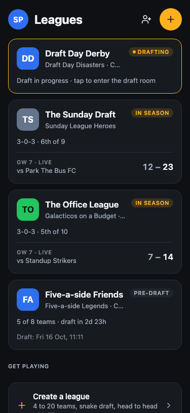
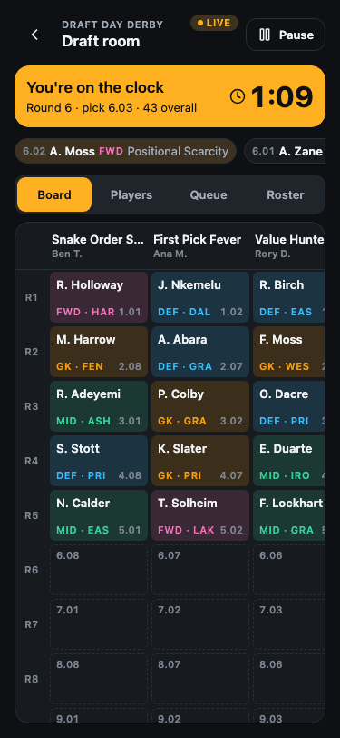
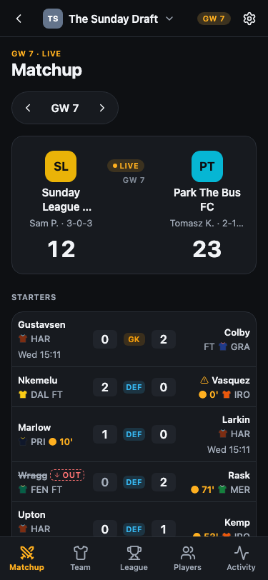
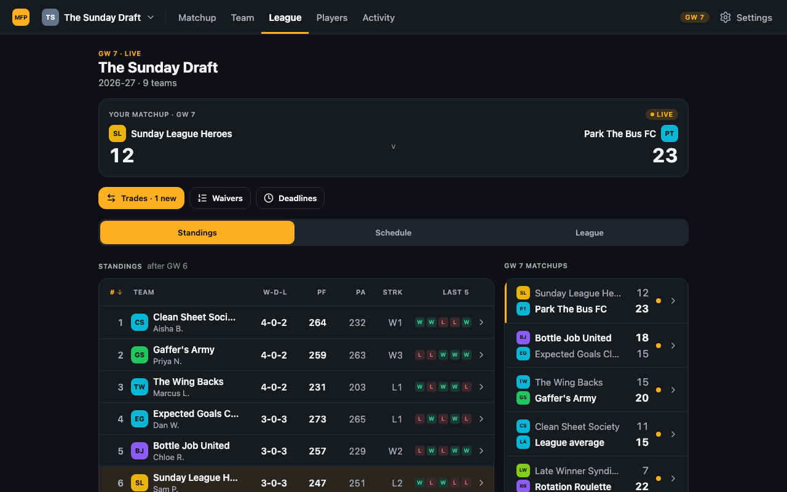
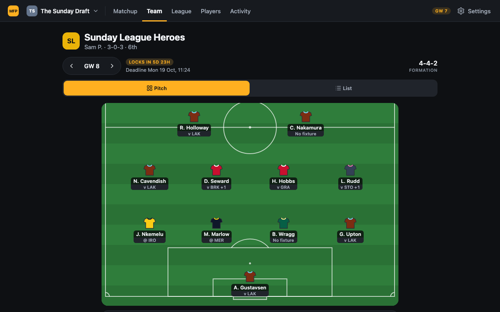

# MyFantasyPrem

A Sleeper-style fantasy draft app for the Premier League, scored with
FPL's official points rules. Leagues, snake drafts, lineups, waivers,
trades and live head-to-head scoring all live in this app. The only outside
data is the player, fixture and live-stats feed (the FPL public API now, a
licensed feed later, behind an adapter). Importing an FPL Draft league is a
later, optional feature.

One Expo codebase builds three clients: desktop web, mobile web and a
native iOS app (in progress; Android later). First users are the owner's
~12-person league. "MyFantasyPrem" is a working name.

The app is dark only (`userInterfaceStyle: 'dark'`) and uses the Geist and
Geist Mono fonts. Inside a league the tabs are Status (the landing tab,
`/leagues/{id}`), Matchup, Team, League (`/leagues/{id}/league`), Players
and Activity; the draft room is `/leagues/{id}/draft`.

The display name, initials and icon colours come from `apps/app/brand.json`.
The lowercase identifier is still hard-coded elsewhere (package and Go
module names, `problemTypeBase` in `server/internal/httpapi/server.go` and
its mirror in `apps/app/src/mocks/handlers.ts`, `inviteBaseURL` in
`server/internal/httpapi/leagues.go` and its mirror in
`apps/app/src/mocks/preseason.ts`, the contract title in `api/openapi.yaml`,
and the database name in `docker-compose.yml`); a rename touches all of them.

_Not affiliated with the Premier League or the Fantasy Premier League. No
PL or FPL logos are used. Official club crests, kits and player photos appear
only in private builds, behind the branded-assets switch (`BRANDED_ASSETS`,
docs/RUNBOOK.md); public builds draw generic shirts._

| Leagues hub (375px)                          | Draft room (375px)                                 | Matchup (375px)                              |
| -------------------------------------------- | -------------------------------------------------- | -------------------------------------------- |
|  |  |  |

| League (1280px)                                  | Draft room (1280px)                                 | Team (1280px)                           |
| ------------------------------------------------ | --------------------------------------------------- | --------------------------------------- |
|  |  |  |

More captures (375px and 1280px) are in [docs/screenshots/](docs/screenshots/).

## Features (v1)

- Accounts: email magic links and account deletion. Sign in with Apple and
  Google: the server verifies the tokens; the iOS app signs in natively
  (Apple needs a paid team, Google an iOS client id; docs/IOS.md). The web
  build has no Apple or Google client yet.
- Create and join leagues by invite code; commissioner settings.
- Snake draft with a durable pick clock and autopick.
- Lineups with deadline locks and auto-subs.
- Waivers and free agents.
- Trades with commissioner or league-vote review.
- Live head-to-head matchups with points breakdowns, standings, schedule.
- Players list and player cards; activity feed.
- Realtime updates over a WebSocket; score recomputation and corrections.

Not built yet: the deadlines page (placeholder), native (iOS) push notifications, chat. Web
Push notifications and the FPL Draft import are built.

## Tech stack

| Area     | Choice                                                                                                     |
| -------- | ---------------------------------------------------------------------------------------------------------- |
| App      | Expo 57, Expo Router, React Native 0.86 (+ react-native-web), React 19.2, TanStack Query 5, TypeScript 5.9 |
| Server   | Go 1.27, std `net/http` + `log/slog`, oapi-codegen strict server, River 0.49 (jobs), coder/websocket       |
| Data     | Postgres 17, pgx 5, goose migrations, hand-written SQL                                                     |
| Contract | OpenAPI 3.1 (`api/openapi.yaml`), openapi-typescript 7.13 + openapi-fetch 0.17 on the client               |
| Testing  | Jest 29 (jest-expo) + Testing Library, MSW 3 mocks, Go `testing`, Playwright 1.64                          |
| Infra    | Docker Compose for local Postgres; GitHub Actions CI; EAS for native builds (not yet linked)               |

Recommended hosting: a roughly EUR 7/month Hetzner VPS running the API and
Postgres in Docker, with Cloudflare Tunnel/Pages/R2 and Resend for email.
An Oracle Always Free VM is the $0 alternative. The deploy kit is in
`deploy/` and the runbook is `docs/DEPLOY.md`; set `APP_ENV=production`
there (`docs/RUNBOOK.md`, Production).

## Repo layout

```
api/openapi.yaml      the contract (source of truth)
apps/app/             Expo app: src/app (routes), components, theme, api, lib, mocks
packages/api-client/  generated TS types + openapi-fetch client
server/               Go API
  cmd/                api, migrate, seed, admin
  internal/           httpapi, auth, league, draft, lineup, waivers, trades, scoring (pure),
                      jobs, realtime, stats, poller, provider, store, demo, ...
e2e/                  Playwright tests against the mock build
e2e-server/           Playwright smoke tests against the real API
scripts/              dev-stack, e2e-server, go-db-tests (+ test-postgres), screenshots, icons, verify-prod-bundle
docs/                 ARCHITECTURE, RUNBOOK, realtime, adr/, design/, research/, screenshots/
docker-compose.yml    Postgres 17: db (dev, :5432) and db-test (:5433, tmpfs, manual use only)
deploy/               production compose stack, VM bootstrap, backups, deploy script
.office/checks        the merge gate
```

## Quick start

Prerequisites: Node 26 (`.nvmrc`; `engines` says >= 24) with plain npm, Go
(version in `server/go.mod`), and Docker for the full stack (the local
Postgres for `npm run dev:stack` and `npm run test:go:db`). Playwright
browsers for e2e: `npx playwright install chromium webkit` (most
specs run on Chromium; the keyboard and branded-image specs also run on
WebKit).

### A. UI only, on mock data

```bash
npm ci
npm run dev:web:mocks   # http://localhost:8081, no backend
```

Sign in with any email; the mock build signs you in at once as "Sam P.".
Mock leagues cover every state (live gameweek, live draft, pre-draft,
join by invite code).

### B. Full stack: real Go server + Postgres + demo data

```bash
npm ci
npm run dev:stack   # Postgres, migrations, demo seed, API on :8080
npm run dev:web     # second terminal: web app on :8081
```

Sign in as `demo@myfantasyprem.test` ("Email me a sign-in link"). The API
terminal prints a `dev magic link` line; open its link, or type its
6-digit code on the "Check your inbox" screen. You are commissioner of "The Sunday Draft" (nine teams, gameweek 7
live) and of "Late Kickoff" (six teams, drafted mid-season after gameweek
7's deadline, so it starts at gameweek 8; two managers missed a pick
clock). The other managers are `priya@`, `olu@`, `jess@`, `marco@`,
`hannah@`, `dev@`, `tomas@` and `ellie@` `myfantasyprem.test`; sign in as
them in another browser profile to try trades or a draft. The demo world
is fictional and never calls FPL.

No Docker: `AUTH_DEV_MAGIC_LINKS=true npm run dev:server` runs the same
demo in memory (data is lost on restart).

### C. Port 8080 is taken

```bash
HTTP_ADDR=:8090 npm run dev:stack
```

Then put `EXPO_PUBLIC_API_BASE_URL=http://localhost:8090` in
`apps/app/.env.development.local` (git-ignored) and run
`npx expo start --web --clear` once from `apps/app`. More in
[docs/RUNBOOK.md](docs/RUNBOOK.md#local-stack-app-against-the-real-server).

## Development workflow

- **Contract first.** Edit `api/openapi.yaml`, run `npm run gen` (TS types
  and Go server), commit the generated files. CI fails on drift. Every
  success body is `{data, meta}`; errors are problem+json; ids are opaque
  prefixed ULIDs.
- **The gate.** `.office/checks` lists commands that must all pass from
  the repo root. CI (`.github/workflows/ci.yml`) runs a similar set, but
  runs the Postgres suites through `npm run check` with `TEST_DATABASE_URL`
  pointing at its service container, not `test:go:db`.

| Command                                              | What it does                                                              |
| ---------------------------------------------------- | ------------------------------------------------------------------------- |
| `npm ci`                                             | Install.                                                                  |
| `npm run gen && test -z "$(git status --porcelain)"` | Regenerate; fails if generated files drifted.                             |
| `npm run check`                                      | ESLint, Prettier check, typecheck, Jest, Go vet/gofmt/test.               |
| `npm run test:go:db`                                 | Local gate only: all Go tests incl. Postgres, on a throwaway DB (Docker). |
| `npm run build:web && npm run verify:prod-bundle`    | Production SPA; fails if mock code reached `apps/app/dist`.               |
| `npm run build:web:mocks && npx playwright test`     | Playwright e2e against the mock build.                                    |

- **Testing layers.** Jest (app); Go unit tests plus Postgres integration
  tests (`test:go:db`); Playwright on mocks (`e2e/`); Playwright against
  the real API and a seeded database (`npm run test:e2e:server`, needs
  Docker, which it uses for its own throwaway Postgres; not part of the gate). Expected values in tests come from the
  rules and the spec (FPL scoring rules, the OpenAPI contract), never
  copied from what the implementation currently returns.
- **Other scripts.** `npm run db:migrate`, `db:seed`, `admin` (rescore,
  tick, run waivers, dev sessions), `screenshots`, `icons`. Full list in
  `package.json`.
- Conventional Commits, small and logical. See [AGENTS.md](AGENTS.md) for
  the repo rules (official images only behind the branded-assets switch,
  never call FPL from tests).

## Architecture

- One Expo (Expo Router) app, web first; the same code ships to iOS.
- Go modular monolith on Postgres; `scoring` is pure, no `internal/` package
  except `httpapi` imports `net/http`, besides upstream HTTP clients
  (`provider/fpl`, `idp`) and `cmd/api`.
- Contract first: `api/openapi.yaml` generates both the TS client and the
  Go server interface.
- Stats come from a single poller behind a `StatsSource` interface, so the
  FPL public API can be swapped for a licensed feed.
- Scheduled work (pick clocks, waiver runs, trade windows) runs on River
  in the API process; realtime updates use a WebSocket backed by a Postgres
  event log.

Full picture: [docs/ARCHITECTURE.md](docs/ARCHITECTURE.md),
[docs/realtime.md](docs/realtime.md), [docs/RUNBOOK.md](docs/RUNBOOK.md),
[docs/IOS.md](docs/IOS.md) (Simulator, iPhone, TestFlight, native tests),
[UI brief](docs/design/BRIEF.md).

### Decision records

- [0001 Expo universal app, web first](docs/adr/0001-expo-universal-app-web-first.md)
- [0002 Go modular monolith and Postgres](docs/adr/0002-go-modular-monolith-postgres.md)
- [0003 Contract-first OpenAPI with codegen on both sides](docs/adr/0003-contract-first-openapi.md)
- [0004 Provider interfaces: StatsSource and LeagueMirrorSource](docs/adr/0004-stats-provider-abstraction.md)
- [0005 Score correctness](docs/adr/0005-score-correctness.md)
- [0006 Opaque public ids and the player identity map](docs/adr/0006-public-ids.md)
- [0007 Asynchronous league import](docs/adr/0007-async-import.md)
- [0008 Native leagues: the app runs the league](docs/adr/0008-native-leagues.md)
- [0009 Persistence: pgx, goose migrations and hand-written SQL](docs/adr/0009-persistence-migrations-query-layer.md)
- [0010 League state aggregate and scheduled jobs on River](docs/adr/0010-league-state-and-scheduled-jobs.md)
- [0011 Realtime over WebSocket with a Postgres event log](docs/adr/0011-realtime-websocket.md)

## Roadmap

1. **Now:** bug fixes, test hardening, the deploy kit, iOS readiness.
2. **Deploy for the owner's league:** $0 hosting plus roughly $10/yr for a domain.
3. **TestFlight:** needs the Apple Developer Program ($99/yr).
4. **App Store.**
5. **Later:** native push notifications, chat, Android, a licensed data feed.

## License and status

License: TBD by the owner.

Pre-release; version 0.1.0.
