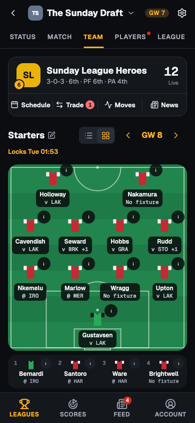
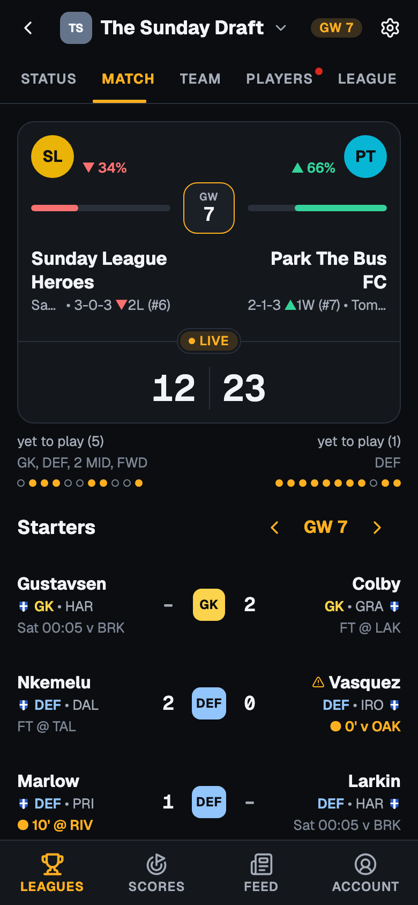
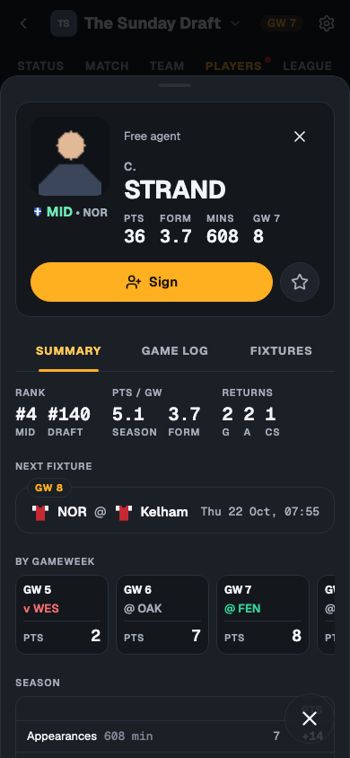
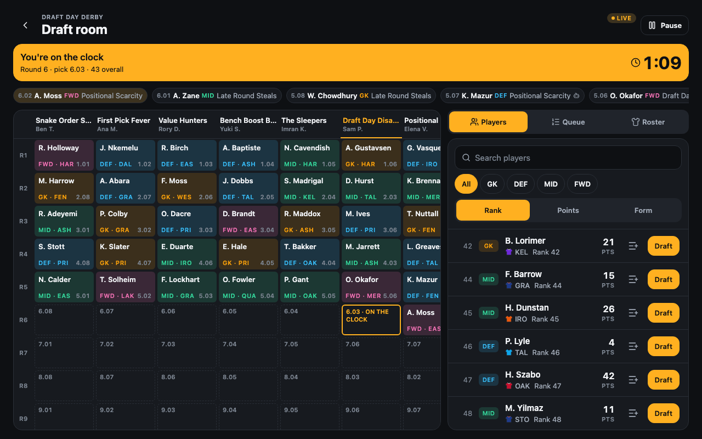

# MyFantasyPrem

A Sleeper-style app for running a private Premier League draft league,
scored with the official FPL Draft points rules. Start a new league or bring
an existing FPL Draft league across, then draft, set lineups, make moves and
follow head-to-head matches live, all in one place.

It runs on the web (desktop and phone) and as a native iOS app, from one
codebase.

| Team                                                                     | Match                                                              | Player card                                                       |
| ------------------------------------------------------------------------ | ------------------------------------------------------------------ | ----------------------------------------------------------------- |
|  |  |  |



## Features

### Leagues

- **Create a league** and choose its settings as commissioner: team count,
  pick clock, waiver order and trade review.
- **Import an existing FPL Draft league** mid-season: paste the league link
  or ID, confirm it is yours, and the teams and squads come across. No FPL login is needed.
- **Invites and claim links.** Friends join a new league with an invite
  code or link. In an imported league, each manager gets a claim link that
  hands them their existing team.
- **Sign in** with an emailed link or code; on iOS, also with Apple or
  Google.

### Draft

- Live snake draft room with a board of every pick.
- A pick clock for each turn, with a banner when a manager misses it.
- A personal queue you can reorder; autopick drafts from it (or the best
  available player) when your clock runs out.

### Lineups

- Your squad on a pitch view, with a list view as an alternative, plus an
  ordered bench.
- Swap players before each gameweek's deadline; lineups lock at the
  deadline.
- Automatic substitutions from the bench when a starter does not play.

### Moves

- **Waivers** with claims processed at the league's waiver deadline, and
  **free agency** once waivers clear.
- **Trades** between managers, with review by the commissioner or a league
  vote, and a trade block to show who you are willing to move.

### Match tab

- Head-to-head view of you and your opponent, slot by slot.
- A gameweek picker to step back through past results or forward to
  previews of upcoming matchups.
- A points share bar for each side, and a points breakdown for every
  player.

### Live scoring and standings

- Scores update live during matches, including provisional bonus points.
- League table, schedule and results for every team; a Scores tab with
  every Premier League fixture.

### Players

- Searchable, sortable player list with free agents and rostered players.
- Player cards with a season summary, game log, upcoming fixtures and
  injury news.

### Notifications and realtime

- Notifications for trades, waiver results, draft turns, lineup problems,
  player news and live events from your players and your opponent's, with
  a switch for each type per league. Everything also lands in an in-app
  inbox; web push is supported.
- Realtime updates: picks, moves and scores appear for everyone in the
  league without a refresh.

## Tech stack

- **App:** Expo and React Native with Expo Router, one TypeScript codebase
  for the web and iOS.
- **Server:** Go API with a typed OpenAPI contract shared with the app.
- **Data:** Postgres.
- **Realtime:** WebSockets push league events to every open client.

## Running locally

Prerequisites: Node 26 (see `.nvmrc`), Go 1.27 (see `server/go.mod`) and
Docker.

```bash
npm ci
npm run dev:stack   # Postgres, migrations, demo data and the API
npm run dev:web     # in a second terminal: the web app on http://localhost:8081
```

Sign in as `demo@myfantasyprem.test`. The API terminal prints the sign-in
link and code. The demo leagues are fictional and make no calls to FPL.

Run the tests and linters with:

```bash
npm run check
```

Self-hosting notes live in [docs/DEPLOY.md](docs/DEPLOY.md).

## License

All rights reserved.
