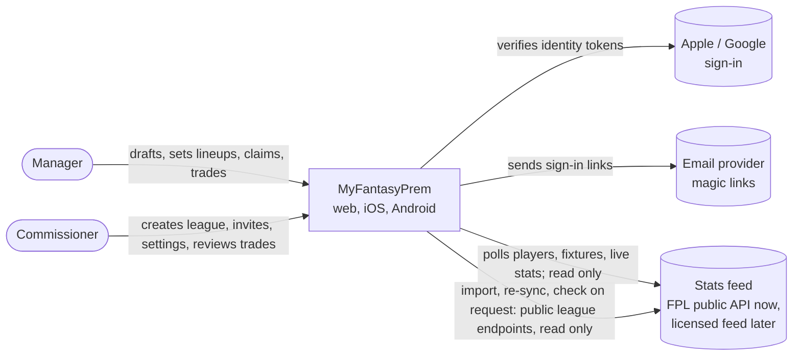
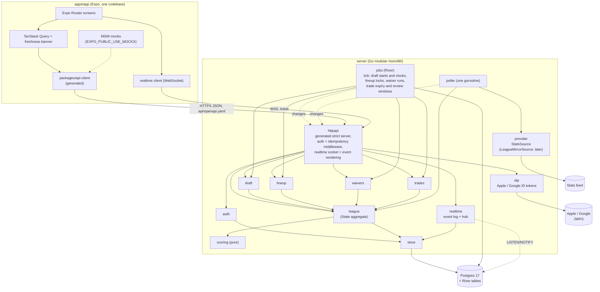
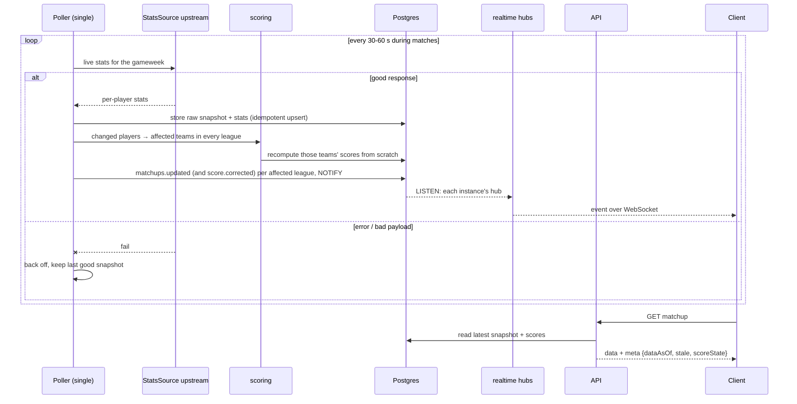

# Architecture

Status: backend phase 2. Every v1 operation is real on Postgres:
accounts (email magic links, Sign in with Apple and Google, deletion),
league management, the draft engine, lineups, waivers and free agents,
trades with review, the global stats feed (FPL client and poller), score
recomputation and corrections, every league read (the Status page, Player
and Team of the Week and per-game player stats included), scheduled jobs on
River, the realtime WebSocket channel, and importing an FPL Draft league
already in its season (playable here at once), re-syncing it from FPL
when its commissioner asks and checking it against FPL with our engines
(ADR 0012). The app's screens run on mock data or on
this server.
Where this document describes something not built yet it says so.
Rationale lives in the ADRs:
[0001 Expo web first](adr/0001-expo-universal-app-web-first.md),
[0002 Go modular monolith + Postgres](adr/0002-go-modular-monolith-postgres.md),
[0003 contract-first OpenAPI](adr/0003-contract-first-openapi.md),
[0004 provider interfaces](adr/0004-stats-provider-abstraction.md),
[0005 score correctness](adr/0005-score-correctness.md),
[0006 public ids](adr/0006-public-ids.md),
[0007 async import](adr/0007-async-import.md),
[0008 native leagues](adr/0008-native-leagues.md),
[0009 persistence](adr/0009-persistence-migrations-query-layer.md),
[0010 league state and jobs](adr/0010-league-state-and-scheduled-jobs.md),
[0011 realtime](adr/0011-realtime-websocket.md),
[0012 FPL league import](adr/0012-fpl-league-import.md),
[0013 claim-link sign-in](adr/0013-claim-link-sign-in.md),
[0014 projections](adr/0014-projections.md). Background:
[RESEARCH.md](research/RESEARCH.md) §6–§9, §12. Realtime:
[realtime.md](realtime.md). Design: [design/BRIEF.md](design/BRIEF.md).

v1 is a standalone, Sleeper-style fantasy app for the Premier League
(ADR 0008): leagues, drafts, lineups, waivers and trades live in this app,
and scoring applies FPL's 2026-27 rules to player match stats. The only
outside data is the global stats feed, plus, for an imported league when
it is imported, re-synced or checked, FPL Draft's public league endpoints
(ADR 0012).

## Context



## Containers



The server's packages:`httpapi` (generated routes, bearer auth, Idempotency-Key replay on
Postgres, request/response mapping, the realtime ticket and socket, and
`Server.Notify`, which renders league changes into realtime events),
`auth` (accounts, sessions, identities), `league` (league management, the
game state and the per-league `State` aggregate the rule packages change,
ADR 0010), the rule packages `draft`, `lineup`, `waivers` and `trades`,
`jobs` (River and the memory scheduler, the tick, the FPL import, re-sync
and check jobs), `mirror` (importing, re-syncing and checking FPL Draft
leagues), `realtime` (the event
log, tickets and hub), `idp` (Apple and Google ID tokens), `stats` (tier-1
data and ingest), `provider/fpl` (the FPL Draft `StatsSource`), `poller`
(the single stats poller, a goroutine in `cmd/api` behind
`POLLER_ENABLED`), `scoring` (pure), `store` (pool, migrations, test
databases), `demo` (the fictional demo world and seed), `ids` and `config`.
Every store has a Postgres and a memory implementation of one interface
(ADR 0009).

## Module boundaries (server/internal)

| Package         | Owns                                                                                                                                                                                                                                       | May depend on                                                       |
| --------------- | ------------------------------------------------------------------------------------------------------------------------------------------------------------------------------------------------------------------------------------------ | ------------------------------------------------------------------- |
| `httpapi`       | Generated routes, auth and idempotency middleware, request/response mapping, problem+json, realtime socket and events                                                                                                                      | every domain package, `config`, `ids`                               |
| `auth`          | Users, identities (Apple, Google, email), sessions, refresh rotation, magic links, deletion                                                                                                                                                | `ids`, `store`                                                      |
| `idp`           | Apple and Google ID token verification against their JWKS (an upstream HTTP client)                                                                                                                                                        | nothing in the app                                                  |
| `league`        | Leagues, settings, invites, members, teams, game state (rosters, lineups, schedule), the `State` aggregate and its SQL, standings, score recompute                                                                                         | `scoring`, `stats`, `store`, `ids`                                  |
| `draft`         | Snake order, pick clock, autopick (queue, then rank), board, draft completion                                                                                                                                                              | `league`, `scoring`, `stats`, `ids`                                 |
| `lineup`        | XI and bench per gameweek, formation rules, deadline locks and their announcement                                                                                                                                                          | `league`, `scoring`, `stats`                                        |
| `waivers`       | Claims, waiver runs in the league's order (reverse standings or rolling), free-agent moves, add/drop locks, the waiver cycle                                                                                                               | `league`, `stats`, `ids`                                            |
| `trades`        | Offers, accept/decline/withdraw/expire, review (commissioner or league vote), execution                                                                                                                                                    | `league`, `scoring`, `stats`, `waivers`, `ids`                      |
| `jobs`          | The tick and job dispatch; River on Postgres, timers in memory                                                                                                                                                                             | `draft`, `lineup`, `waivers`, `trades`, `league`, `stats`, `mirror` |
| `mirror`        | FPL Draft import, re-sync and check: plan (roster replay, lineups), reset and apply by refs, verify with our engines; imports, picks cache, sync record, reports, explanations (ADR 0012)                                                  | `provider`, `league`, `scoring`, `stats`, `store`, `ids`            |
| `tradeblock`    | The trade block: put a player on it (note, wanted positions), change or remove his entry, list it. Entries live in the `State` (`Block`), stored by `league` in `trade_block`; every save drops an entry whose stint ended                 | `league`, `ids`                                                     |
| `tags`          | Each member's private tag on a player in a league (hot, cold, target, sell, avoid), its own SQL (`player_tags`), memory and Postgres                                                                                                       | nothing in the app                                                  |
| `notifications` | Notification types, per-league preferences (default on), the inbox, push devices, the push outbox and dispatcher, producers from league changes, deadlines, live stats and news (ADR 0015); `notifications/webpush` is the Web Push client | `league`, `draft`, `stats`, `scoring`, `store`, `ids`               |
| `realtime`      | Event log (per-league `seq`, 5-minute replay), tickets, hub (subscriptions, replay, backpressure), LISTEN/NOTIFY                                                                                                                           | `store`                                                             |
| `scoring`       | Pure functions: stats → points (FPL 2026-27), bonus from BPS, lineup rules, auto-subs, H2H, average, Player and Team of the Week                                                                                                           | nothing                                                             |
| `statuspage`    | Pure rules of the Status page: form, attention items, top available by form, injuries and chance of playing                                                                                                                                | nothing                                                             |
| `projection`    | Pure rules of fixture difficulty, Expected points, win odds and start/sit accuracy (ADR 0014)                                                                                                                                              | `scoring`                                                           |
| `stats`         | Tier 1: clubs, players, gameweeks, fixtures, per-fixture stats and points, poll state; ingest; snapshot pruning                                                                                                                            | `scoring`, `provider`, `store`, `ids`                               |
| `poller`        | The single stats poller: cadence, backoff, last-good snapshot, rescoring, metrics                                                                                                                                                          | `provider`, `stats`, `league`                                       |
| `store`         | Postgres pool, embedded goose and River migrations, transactions, test databases (`storetest`)                                                                                                                                             | nothing in the app                                                  |
| `provider`      | `StatsSource`, `LeagueMirrorSource` and provider-neutral types; `provider/fpl` (both, on FPL Draft's public API)                                                                                                                           | nothing in the app                                                  |
| `demo`          | The fictional demo world (FPL JSON shapes, embedded) and `Seed`, for local runs and tests                                                                                                                                                  | `auth`, `league`, `stats`, `poller`                                 |
| `leaguetest`    | Test helpers: the demo season and leagues on memory and Postgres (tests only)                                                                                                                                                              | `auth`, `demo`, `league`, `stats`, `store`                          |
| `ids`           | Opaque prefixed ULID ids                                                                                                                                                                                                                   | nothing                                                             |
| `config`        | Env parsing                                                                                                                                                                                                                                | nothing                                                             |

Rules: no `internal/` package imports `net/http` except `httpapi` (the
server side) and upstream HTTP clients: provider implementations such as
`provider/fpl`, and `idp`; only `cmd/api` uses it outside `internal/`;
`scoring` does no I/O; FPL-specific
code sits behind `provider` so a licensed feed can replace it. Public ids
are our own opaque strings; providers return external ids that `stats`
maps through `player_external_id` (players) and `external_ref` (clubs,
fixtures) (ADR 0006). Domain packages own their SQL, except that `league`
stores the draft, waiver and trade tables for the rule packages (the
`State` aggregate, ADR 0010) and the trade block; `store` only provides the
plumbing (ADR 0009). Player news has no package of its own: `httpapi`
serves it from `stats` players (see "Trade block, player news and tags").

## Data tiers

| Tier                | What                                                                                                                       | Written by                                    | Read by                                            |
| ------------------- | -------------------------------------------------------------------------------------------------------------------------- | --------------------------------------------- | -------------------------------------------------- |
| 1. Global stats     | Seasons, clubs, players, gameweeks and deadlines, fixtures, per-player per-fixture stats and points, raw snapshots         | The poller only, from `StatsSource`           | Every league; one copy shared by all               |
| 2. Per-league state | Leagues, settings, members, teams, invites, the draft and its picks, rosters, schedule, waiver order, trades, feed, scores | API handlers and jobs, in strict transactions | Members of that league                             |
| 3. Per-user private | Lineups before the deadline, the draft queue, pending waiver claims, trade offers not yet accepted, sessions               | The owning user                               | The owner (and the server); public after the event |

Scores are derived: a team's gameweek score is a pure function of tier 1
(stats), tier 2 (the roster that gameweek) and the locked tier-3 lineup, and
is recomputed from scratch when any of them changes (ADR 0005).

## Data model (Postgres)

The schema is `server/internal/store/migrations/` (goose, embedded; ADR
0009); this sketch follows it. Keys are our public ids (`text`, prefixed
ULID) unless noted. `→` is a foreign key. River's own tables (`river_job`,
`river_leader`, ...) are applied after ours by `rivermigrate` (ADR 0010).

```
-- tier 1: global stats (shared)
seasons            (id '2026-27' PK, current_gameweek, next_gameweek, waivers_processed)
clubs              (id clb_ PK internal, season → seasons, code, name)  UNIQUE(season, code)
players            (id plr_ PK, display_name, position, club_id → clubs, availability, news, draft_rank,
                    news_at NULL, chance_next NULL 0-100)  -- FPL news_added, chance_of_playing_next_round
player_external_id (player_id → players, provider, external_id, season NULL, match_method, confidence, verified_at)
                   UNIQUE NULLS NOT DISTINCT (provider, external_id, season)            -- ADR 0006
external_ref       (entity club|fixture, provider, external_id, season NULL, internal_id)
                   UNIQUE NULLS NOT DISTINCT (entity, provider, external_id, season)
gameweeks          (season, number, deadline_at, waiver_deadline_at, trade_deadline_at,
                    finished, bonus_added, data_checked)  PK(season, number)
fixtures           (id fx_ PK, season, gameweek, home_club_id, away_club_id, kickoff_at, status,
                    home_score, away_score)
player_fixture_stats (player_id, fixture_id, gameweek, minutes, goals, assists, clean_sheet, goals_conceded,
                    own_goals, pens_saved, pens_missed, yellow, red, saves, cbi, tackles, recoveries,
                    bps, bonus, bonus_provisional, points, rev)  PK(player_id, fixture_id)
player_gameweek_stats (gameweek, player_id, minutes, goals, assists, clean_sheets, goals_conceded, own_goals,
                    pens_saved, pens_missed, yellow, red, saves, bonus, bps, cbi, tackles, recoveries,
                    defensive_contribution, influence, creativity, threat, ict_index, expected_goals,
                    expected_assists, expected_goal_involvements, expected_goals_conceded)
                   PK(gameweek, player_id)   -- upstream's gameweek line, never scored; ICT/xG NULL if unpublished
stat_snapshots     (id bigserial PK, kind, gameweek, fetched_at, payload_sha256, payload jsonb,
                    final)                -- deduplicated; final = taken once the gameweek was checked
poll_state         (id 1 PK, mode, gameweek, last_attempt_at, last_good_at, next_poll_at,
                    last_error, consecutive_failures)                   -- drives meta.stale
rescore_pending    (gameweek PK, marked_at)  -- stats changed, scores not yet recomputed; survives restarts

-- accounts
users              (id usr_ PK, display_name, email NULL UNIQUE, avatar_color, created_at)  -- deleted = row gone
auth_identities    (provider apple|google|email, subject, user_id → users, apple_refresh_token NULL: sealed, AES-256-GCM)
                   PK(provider, subject)
sessions           (id PK, user_id → users, access_sha256 UNIQUE, access_expires_at,
                    refresh_sha256 UNIQUE, refresh_expires_at)          -- revoked = row gone
used_refresh_tokens(refresh_sha256 PK, session_id → sessions)                          -- reuse detection
magic_links        (token_sha256 PK, seq, email, expires_at, used_at, code_sha256, code_failures)
sign_in_code_failures (email, failed_at)                     -- wrong codes, kept 24 hours
signin_links       (code_sha256 PK, user_id → users, league_id, expires_at, created_at)  -- ADR 0013; used/replaced = row gone
idempotency_keys   (user_id, key, fingerprint, status in_flight|done, response_status,
                    response_headers jsonb, response_body bytea, created_at)  PK(user_id, key)

-- tier 2: per league
leagues            (id lg_ PK, name, season, status, source native|fpl_import,
                    fpl_league_id NULL, commissioner_id → users, created_at)  -- ADR 0012
league_settings    (league_id → leagues, version, settings jsonb, effective_from_gw)  PK(league_id, version)
teams              (id tm_ PK, league_id → leagues, name, owner_id → users NULL, joined_at,
                    fpl_entry_id NULL, fpl_manager_name NULL)
                   UNIQUE(league_id, owner_id)                    -- owner NULL: orphaned, or an unclaimed seat
invites            (id inv_ PK, league_id → leagues, code UNIQUE, max_uses, uses, expires_at, revoked_at,
                    team_id NULL → teams)                         -- set: a seat's claim link
drafts             (id drf_ PK, league_id UNIQUE → leagues, status, starts_at, pick_timer_s,
                    clock_started_at, paused_at, completed_at)   -- the clock's deadline is derived
draft_order        (draft_id → drafts, slot, team_id → teams)  PK(draft_id, slot)
draft_autopick     (draft_id → drafts, team_id → teams)  PK(draft_id, team_id)
draft_stay_manual  (draft_id → drafts, team_id → teams)  PK(draft_id, team_id)  -- "autopick when my clock runs out" off
draft_picks        (id pk_ PK, draft_id → drafts, overall, team_id → teams, player_id → players,
                    method, picked_at, missed_clock)  UNIQUE(draft_id, overall), UNIQUE(draft_id, player_id)
roster_slots       (id bigserial, league_id, team_id → teams, player_id → players, from_gw, to_gw NULL,
                    acquired_via, txn_id NULL)
                   EXCLUDE USING gist (league_id WITH =, player_id WITH =,
                                       int4range(from_gw, to_gw) WITH &&)  -- one owner per player
matchups           (id mu_ PK, league_id, gameweek, home_team_id NULL, away_team_id NULL,
                    home_points, away_points, state)  -- NULL side = the league-average opponent
waiver_priority    (league_id, team_id, rank, as_of)  PK(league_id, team_id)
waiver_locks       (league_id, player_id, until_gw, reason added|dropped)  PK(league_id, player_id)
league_runs        (league_id, gameweek, kind waivers|lineup_lock, ran_at)  PK(league_id, gameweek, kind)
transactions       (id txn_ PK, league_id, kind, gameweek, payload jsonb, occurred_at,
                    fpl_txn_id NULL)                                    -- the activity feed
league_refs        (league_id, entity team|match|transaction|trade, provider, external_id, internal_id)
                   PK(league_id, entity, provider, external_id)         -- upstream ids, saved with the State
trades             (id trd_ PK, league_id, offering_team_id, receiving_team_id, status, message,
                    created_at, expires_at, responded_at, review_ends_at, processed_at,
                    review_mode NULL, decided_by NULL, decision_reason NULL, failure_reason NULL,
                    effective_gw NULL)
trade_items        (trade_id → trades, player_id → players, from_team_id, ord)  PK(trade_id, player_id)
trade_votes        (trade_id → trades, team_id → teams, vote)  PK(trade_id, team_id)
trade_block        (league_id → leagues, team_id → teams, player_id, note ≤ 140, wanted text[], added_at)
                   PK(league_id, player_id)                             -- public to members (migration 00015)
team_gw_scores     (team_id, gameweek, points, bench_points, autosubs jsonb, state, rev)
                   PK(team_id, gameweek)
realtime_seq       (league_id PK, seq)                                  -- per-league event counter
realtime_events    (league_id, seq, type, payload jsonb, sent_at, audience text[] NULL, per_team jsonb NULL)
                   PK(league_id, seq)                                   -- 5-minute replay
realtime_tickets   (ticket_sha256 PK, user_id → users, session_id NULL → sessions, league_id NULL, expires_at, used_at)

-- FPL import (ADR 0012)
imports            (id imp_ PK, user_id → users, fpl_league_id, seat, status, done, total, error jsonb,
                    league_id, created_at, updated_at)  UNIQUE(user_id, fpl_league_id) WHERE active or succeeded
mirror_picks       (provider, entry_id, gameweek, picks jsonb)  PK(...)  -- finished gameweeks only
mirror_sync        (league_id PK, last_attempt_at, last_synced_at, last_error, pending resync|check NULL, requested_at, note)
mirror_reports     (id, league_id, checked_at, status clean|mismatch|incomplete, items jsonb)  -- newest 50 kept
mirror_explanations(league_id, key, ours, theirs, note, explained_by, explained_at)  PK(league_id, key)

-- tier 3: per user, private until the event
lineups            (team_id → teams, from_gw, slots text[15], updated_at)  PK(team_id, from_gw)
draft_queue        (team_id → teams, rank, player_id → players)  PK(team_id, player_id)
player_tags        (user_id → users, league_id → leagues, player_id, tag, updated_at)
                   PK(user_id, league_id, player_id)  -- private to the user, like the watchlist (00015)
waiver_claims      (id wv_ PK, league_id, team_id, add_player_id, drop_player_id, pref_order,
                    gameweek, status, failure_reason, processed_at, created_at)
```

Rules the database enforces: one owner per player per league per gameweek
(the exclusion constraint), one pick per slot and per player per draft,
one vote per team per trade, the public id patterns (`CHECK`). Every
change to a league's draft, lineups, claims, rosters or trades is one
transaction on its `State`, with the league row locked (ADR 0010), so
concurrent changes to one league queue up; a waiver run, a pick clock
and trade closing check their own run markers or status and are safe to
repeat.

Materialised vs derived: `player_fixture_stats.points`, `team_gw_scores`
and the matchup points/state are written by the recompute; standings are
derived on read from the matchups of finished gameweeks. The league reads
(matchups, lineups, teams, players) score from scratch on every request
with the same functions, so they always agree with the stats.

## Auth

- Sign in with Apple (identity token; nonce required and checked),
  Google (ID token; nonce checked when the client sends one) or an email
  magic link (single use, 15 minutes; the app takes the token out of the
  URL at once and signs in only on a tap). The same email carries a
  6-digit code (`POST /v1/auth/email/code`) for signing in where the link
  is awkward to open; the link and the code are one sign-in, whichever is
  used first. The link carries `next` (a path in the app, such as the
  invite being joined, checked on both ends). All three end in the
  same session. `idp` verifies Apple and Google tokens (RS256) against the
  provider's JWKS, cached by `Cache-Control` and refetched at most once a
  minute for an unknown key, with the issuer, the audience
  (`APPLE_CLIENT_IDS`, `GOOGLE_CLIENT_IDS`; without them that sign-in
  answers 503), expiry and issue time checked. An identity seen before
  signs into its account; a new one with a verified email links to the
  account with that email; otherwise a new account is created. The JWKS
  fetch runs outside the verifier's lock, one fetch for all waiters. With
  the `APPLE_*` token settings, `idp.AppleTokens` exchanges the Apple
  authorization code for a refresh token (ES256 client secret), stored
  sealed with AES-256-GCM and revoked at account deletion.
- Sessions are opaque bearer tokens: a 1-hour access token and a 60-day
  refresh token that rotates on every use; presenting a rotated-out refresh
  token revokes the session. Only SHA-256 hashes are stored.
- `httpapi` requires `Authorization: Bearer` on every route except the
  `security: []` operations (health, sign-in, refresh, clubs, the current
  gameweek and invite previews) and the WebSocket (its ticket). A test
  checks that list against the spec.
- Roles are per league: member or commissioner. Team actions (lineups,
  claims, picks, trade responses) need the team's owner; the commissioner
  may also pick for the team on the clock and reviews trades.
- Deleting an account ([account-deletion.md](account-deletion.md))
  cancels the user's pending claims and open offers, revokes every
  session, removes the user's pre-draft teams and orphans drafted ones
  (an open seat, "Open seat"; it keeps playing on autopick and default
  lineups until someone joins with an invite and takes it over),
  and passes a commissioner's role to the longest-standing member.
- Magic links go through `auth.Sender`, picked by `EMAIL_PROVIDER`:
  `ResendSender` (Resend's HTTP API) in production; `LogSender` in
  development (`AUTH_DEV_MAGIC_LINKS=true`), which logs the link
  (`APP_URL/sign-in?token=...`) instead of mailing it; `DisabledSender`
  otherwise. Production hosting: [DEPLOY.md](DEPLOY.md).

## Security

- **Environments.** `APP_ENV=production` refuses to start with dev magic
  links on, without `DATABASE_URL`, `REALTIME_URL`, `APP_URL` or explicit
  `CORS_ALLOWED_ORIGINS` (no `*`), and ignores `X-Forwarded-Host/Proto`.
- **Rate limits.** In-process token buckets in `httpapi` (`ratelimit.go`),
  per client IP (from `X-Forwarded-For` only through `TRUSTED_PROXIES`,
  rightmost untrusted hop; IPv6 by /64), per user and, for magic links,
  per email address: a global limit, sign-in, invite previews and
  accepts, realtime tickets. Images (`/v1/assets/*`) have their own
  per-IP bucket instead of the global one, so a list screen's photos and
  crests never spend the API budget. Sign-out and account deletion with a valid
  token are limited per session only, never per IP. A full table never resets a throttled key;
  new keys share an overflow bucket instead. 429 `rate-limited` with
  `Retry-After`. Per instance; a shared store is a later step if one
  instance's view is not enough.
- **Sign-in codes.** 6 digits from `crypto/rand`, stored only as a
  SHA-256 salted with the link's token hash (a dump does not show them,
  but six digits are quick to brute-force from a hash: what protects a
  code is its 15 minutes, single use and these limits). Only the latest
  email to an address accepts a code. 5 wrong codes end that sign-in
  (link too); 10 wrong codes per address in 24 hours lock code sign-in
  for the address (429 with `Retry-After`, the code is not even
  compared; the link still works) — in Postgres, so they hold across
  instances and restarts, and checked under a per-address advisory lock
  so parallel guesses cannot overshoot. An attacker therefore gets at
  most 10 guesses a day at a one-in-a-million code: under 1 in 100,000
  a day, about 0.4% a year of non-stop trying, while every 5 guesses
  mail the owner a fresh code. Plus the per-IP `/v1/auth/*` limit.
- **Sign-in links** (ADR 0013): 256-bit codes from `crypto/rand`, kept
  only as SHA-256, single use, 7 days; a new one for an account deletes
  its older ones. Issued by an imported league's commissioner, 5 then 2
  a minute per commissioner; used through the per-IP `/v1/auth/*` limit.
- **Invites** expire after 7 days by default; codes are 10 characters of
  a 30-letter alphabet (8-character codes made before still work until
  they expire).
- **Privacy of lineups.** The next gameweek's lineup is private until its
  deadline: `GetLineup` answers 403 and `GetTeam` shows other teams'
  rosters in the order of the last locked lineup.
- **Realtime re-authorization.** Tickets carry the session; leaving,
  removal, logout, refresh-token reuse and deletion close the affected
  sockets on every instance (`realtime_control`), and sockets live at most
  one access-token lifetime ([realtime.md](realtime.md)).
- **Housekeeping.** The prune job deletes expired or used magic links,
  wrong sign-in codes older than 24 hours, expired sessions and idempotency records over a day old; the in-memory
  idempotency store and fake import table are bounded.
- **Claim links as sign-in** (testing phase, `CLAIM_LINK_SIGNIN`, [ADR
  0013](adr/0013-claim-link-sign-in.md)). A seat's claim code is a
  credential: single use per seat (409 once used, 410 once the
  commissioner issues a new one), sent in the body of `POST
/v1/auth/claim` (never in a logged URL), limited per IP with the other
  `/v1/auth/*` routes; the access and panic logs write invite paths as
  `/v1/invites/{code}`. Ordinary invites never sign anyone in. Production
  allows it with a startup warning.
- **Web app.** `index.html` sets `Referrer-Policy: no-referrer` (meta).

### Pre-launch: HttpOnly refresh cookie and CSP (planned, not built)

On the web the session (access and refresh token) lives in JavaScript
storage, so an XSS bug could read the 60-day refresh token. Before the
public web launch:

- Move the web refresh token to an `HttpOnly; Secure; SameSite=Strict`
  cookie scoped to `Path=/v1/auth/refresh` on the API origin, set by the
  sign-in and refresh responses for web clients (native apps keep the
  body token in the keychain). The refresh endpoint reads the cookie when
  no body token is sent; `POST /v1/auth/logout` clears it. CSRF: the
  cookie is SameSite=Strict and refresh also requires a custom header
  (CORS preflight), and CORS allows credentials only for the app origin.
- Keep the 1-hour access token in memory only (not `localStorage`).
- Serve the web app with a Content Security Policy header from the host
  (not a meta tag, so `frame-ancestors` works): `default-src 'self'`;
  `script-src 'self'` (no inline scripts: check the Expo export);
  `connect-src 'self' https://api.<domain> wss://api.<domain>`;
  `img-src 'self' data:`; `style-src 'self' 'unsafe-inline'`
  (react-native-web inline styles); `frame-ancestors 'none'`;
  `base-uri 'none'`; `form-action 'self'`; plus
  `Referrer-Policy: no-referrer` and `X-Content-Type-Options: nosniff` as
  headers. Roll it out as `Content-Security-Policy-Report-Only` first.
- Contract: document the cookie on `/v1/auth/*` and make `refreshToken`
  in the body optional for web clients.

## Contract

`api/openapi.yaml` is the source of truth. `npm run gen` produces the TS types
and the Go strict server; CI fails if the generated files are not committed.
Success bodies are `{data, meta: {dataAsOf, serverTime, stale, scoreState?}}`.
Errors are RFC 9457 `application/problem+json` with a `requestId` (also the
`X-Request-ID` header); the problem `type` slug is stable (`not-your-turn`,
`lineup-locked`, `trade-shape`, ...), 422s list every broken rule in
`errors`, and 5xx details are generic. Every enum is open. Mutating POSTs
accept an `Idempotency-Key`: a retry with the same key and body replays the
first response for 24 hours. A Go test sends at least one request to every
operation, validates requests and responses against the spec with
libopenapi-validator, and checks that each secured operation answers 401
without a token; the realtime tests validate every socket message against
`RealtimeServerMessage`.

The FPL import (ADR 0012, reusing ADR 0007's shapes): `GET
/v1/imports/preview`, `POST /v1/imports` (with the caller's `seat`), `GET
/v1/imports/{importId}`, and per league `GET /sync`, `POST /sync`
(re-sync, confirmed), `POST /sync/check`, `POST /sync/explanations`, `GET
/seats`, `POST /seats/{teamId}/invite`. Previews and new imports reach FPL, so they are
limited to 10 a minute per user in the handlers.

Projections (ADR 0014): `GET /v1/fixture-difficulty`, `GET
/v1/leagues/{leagueId}/gameweeks/{gw}/projections` (Expected per player
and XI, win odds per matchup) and `GET /v1/leagues/{leagueId}/start-sit`.
All are computed on read from the world and the league by package
`projection`; nothing is stored.

## Live-scoring data flow



Poll cadence (RESEARCH §9.4, `poller.Decide`): 30 s while a match is on (or
past its kickoff and not over), every 10 min until bonus is added, every 6 h
until the data is marked checked (but at FPL's 09:00 UK score lock the day
after the last match, then every 10 min for two hours; FPL Draft has no
`data_checked`, so a Draft gameweek counts as checked once its event is
`finished`, ADR 0005), otherwise at the
next kickoff and at most daily; no wait runs past the next kickoff or 30 minutes before the next
gameweek deadline, and waits are timed on the wall clock (host sleep).
Bootstrap (players, clubs, gameweeks, fixtures) refreshes every 6 h, when
the gameweek changes and at once when live data names a player we have not
mapped. FPL Draft's bootstrap lists only the upcoming gameweeks' fixtures,
so each `event/{gw}/live` payload's own `fixtures` (teams, kickoff, status,
score, per-fixture stats) are stored too, merged by upstream fixture code
into the same `fx_` ids. On start and on every rollover the previous gameweek's
final `event/{gw}/live` is fetched again (late corrections) and rescored,
and earlier gameweeks with no stored rows (or no per-player gameweek
lines) are backfilled (4 per cycle, most recent first, at
most 2 requests per second; ones that failed go to the back of the queue,
and while gameweeks never tried remain the next cycle comes after 30 s
rather than the mode's wait). Failures back off exponentially (capped at 10
min) and write nothing: an upstream error, a 404 for the live data after
the gameweek's first kickoff, or an incomplete snapshot (no players after
kickoff, or under half the stored rows) is a failed poll. A rescore that
fails after its ingest committed is retried in full on the next cycle.
Score states move
`upcoming → live → provisional → official → final`; a later correction
recomputes from scratch, and a change to an official or final team score
is reported as `score.corrected` with the points before and after
(`cmd/admin rescore` does the same for any past gameweek).

The poller is one goroutine in one `cmd/api` process (`POLLER_ENABLED=true`;
run it in exactly one instance), on `POLLER_SOURCE=fpl` or `demo`. Each
cycle: gameweek status, bootstrap if due, `event/{gw}/live`, ingest (ids
mapped, double gameweeks split by upstream's breakdown and each fixture's
own BPS, provisional bonus from BPS (from 20 minutes in) until FPL confirms
the fixture's bonus, every row scored with the scoring table FPL
publishes), then `league.Scorer` rescores the in-season leagues whose
rostered players, their clubs' fixture status or the gameweek state moved and reports `matchups.updated` for each league whose
scores or state changed. Rescores of one gameweek (the poller's,
`cmd/admin rescore`) take turns on a Postgres advisory lock
(`Repo.LockScores`) from reading the stats to saving the scores, so a
rescore that read older stats never overwrites a newer one. Ingests that
mint ids for new upstream players, clubs or fixtures take another one
and retry when a concurrent ingest mapped the id first, so one upstream
id never becomes two of ours. Counters (`poller` in expvar) are served on
`METRICS_ADDR` at `/debug/vars`.

`meta.dataAsOf` and `meta.stale` come from `poll_state`
(`stats.Freshness`) for stats-derived data: while a match is live,
`dataAsOf` is the last good poll and the data is stale 3 minutes later.
Between matches nothing upstream moves, so while the poller keeps its
schedule (no failed poll, and the next poll not overdue by 3 minutes)
`dataAsOf` is the server time and `stale` is false; a failing or stopped
poller makes it the last good poll, stale 3 minutes after it. League state
(drafts, claims, trades, settings) carries the server time. The client's
own 3-minute age check therefore only fires when the poller is behind.

## Status page and awards

`GET /v1/leagues/{leagueId}/status`, `GET /v1/gameweeks/{gw}/awards` and
`GET /v1/awards/players-of-the-week` mirror the MSW mocks
(`apps/app/src/mocks/status.ts`). The rules are pure: Player and Team of
the Week in `scoring/awards.go` (the app's `lib/awards.ts`; both test
suites run `scoring/testdata/awards_cases.json`, so the two cannot drift),
the rest in `statuspage`; `httpapi` gathers the inputs.

- **Form** (every `form` in the contract, and the `form` sorts) is the
  mean of a player's points over the last two completed gameweeks before
  the form gameweek: the season's current gameweek (FPL's, the one whose
  deadline passed last) while it is played, the next once it has
  finished. So with gameweek 7 live or up next, form is (GW5 + GW6) / 2. A gameweek without minutes or without a match counts as 0 and
  a double gameweek's points are both matches', so the divisor is always
  2; early in the season it is the number of completed gameweeks (in GW2,
  GW1's points), and in GW1 form is null (shown as "–"). One decimal,
  halves up. The rule is `statuspage.FormGameweek` and `statuspage.Form`
  (the app's `lib/form.ts`, which the mocks use); both test suites run
  `statuspage/testdata/form_cases.json`.
- **Awards** rank every player in the game, owned or not. Points, bonus
  and minutes are the scored rows; BPS, goals, assists, defensive
  contribution (FPL's count) and clean sheets are FPL's gameweek line
  (`player_gameweek_stats`). Player and Team of the Week order players by
  points, then goals, assists, bonus, BPS, defensive contribution and clean
  sheets (more is better), then fewer minutes, then the id
  (`scoring.CompareForAward`, the app's `lib/awards.ts`; both test suites
  run `scoring/testdata/awards_cases.json`). A gameweek that has not
  kicked off is 404.
- **Status** is about the gameweek lineups and roster moves are for (the
  first whose deadline is ahead): starters with no fixture or flagged, the
  caller's trade offers and pending claims; the rank change is between the
  standings after the league's last two completed gameweeks; top
  available lists the next three gameweeks of fixtures from that
  gameweek. Chance of playing is read from FPL's news ("75% chance of
  playing"), 0 for anyone out.
- **Per-game stats** on the player card are FPL's gameweek line (ICT and
  expected stats included); bonus and defensive-contribution points come
  from the points breakdown so they match the points. Everything is null
  until one of the club's fixtures in that gameweek kicks off.

## Scheduled jobs

| Job                     | When                                                        | Does                                                                                                                                                                                                     |
| ----------------------- | ----------------------------------------------------------- | -------------------------------------------------------------------------------------------------------------------------------------------------------------------------------------------------------- |
| Poller                  | 30 s – 6 h by gameweek state (a goroutine, not River)       | Stats snapshot, recompute affected teams, `matchups.updated`, `score.corrected`                                                                                                                          |
| `draft_clock`           | Every pick deadline (River, scheduled with the pick)        | Autopicks for the team on the clock and turns its autopick on                                                                                                                                            |
| `trade_review`          | `review.endsAt` (River, scheduled on acceptance)            | Processes or vetoes the trade (commissioner mode: approved if undecided)                                                                                                                                 |
| `tick` (periodic, 15 s) | `JOBS_TICK`, River's leader; also on start                  | Starts due drafts; settles expired clocks; announces lineup locks (`lineup.locked`); runs waivers at deadline − 24 h (`waivers.processed`); expires offers at the next waiver run; closes review windows |
| `fpl_import`            | On `POST /v1/imports` (River, inserted with the row)        | Fetches the FPL league, plans, applies in one transaction, rescores, verifies, stores the report (ADR 0012)                                                                                              |
| `fpl_resync`            | On the commissioner's `POST /sync` (one pending per league) | Resets the imported league to FPL's current state (cancels open trades and claims), rescores, verifies, writes the notice                                                                                |
| `fpl_check`             | On the commissioner's `POST /sync/check`                    | Verifies the league against FPL without changing it; stores the report                                                                                                                                   |
| `prune` (periodic, 1 h) | River's leader                                              | Drops realtime events older than 5 minutes and expired tickets; prunes stat snapshots, expired or used magic links, day-old wrong sign-in codes, expired sessions and day-old idempotency records        |
| Auto-subs               | When all of a gameweek's fixtures are finished              | Confirms projected auto-subs (part of the poller's recompute)                                                                                                                                            |

Every job is idempotent and re-checks the state under the league lock
(run markers in `league_runs` for waiver runs and lock announcements), so
a duplicate, late or repeated run changes nothing; the tick makes every
deadline durable across restarts (ADR 0010). Lineups need no lock job:
`PUT lineup` refuses a gameweek whose deadline has passed and a lineup
applies until the team's next one, so it carries forward by itself.
The jobs only settle what is due; a request never relies on them having
run: accepting, declining or withdrawing an offer checks `expiresAt`,
votes and commissioner decisions check the review window's end, and a
waiver claim made after the waiver deadline joins the next run while the
due run's claims are frozen (409 `trade-expired`, `trade-review-closed`,
`waivers-processing`). Without a database, `jobs.Memory` runs the same work with timers and a
ticker. `cmd/admin tick` runs the tick once by hand.

## Reliability rules

1. **Keep the last good snapshot.** A failed or malformed poll never replaces it.
2. **Never zero scores on a bad response.** Show the old number, flag it stale.
3. **Stale after 3 minutes** without a good poll: the server sets
   `meta.stale = true`. The client (`apps/app/src/api/freshness.ts`) also
   computes the age itself, without trusting the device clock:
   `(serverTime - dataAsOf) + (now - time the response arrived)`, and treats
   anything over `STALE_AFTER_MS` (3 minutes, `src/constants/app.ts`) as
   stale. Each screen shows one banner, in priority order: "You're offline",
   "Can't reach the server · showing data from hh:mm" (the latest refetch
   failed), "FPL data delayed since hh:mm". The data stays on screen.
4. **Recompute from scratch.** A score is a pure function of roster, lineup and
   latest stats; never patch incrementally.
5. **Idempotent jobs and writes.** Polls, recomputes, waiver runs and re-syncs
   can run twice with the same result; client retries use `Idempotency-Key`.
6. **Be polite upstream:** back off on errors, send a clear User-Agent, cache
   in our layer, not the provider's.
7. Golden tests: FPL's `explain` data is the expected answer for scoring
   (ADR 0005); `server/internal/scoring` pins the rules with table tests
   today.

## Trade block, player news and tags

Migration 00015 added three features that share the Team tab and the
player card.

| Feature     | Endpoints                                                                             | Server                                                            | Visible to                 | Realtime                                     |
| ----------- | ------------------------------------------------------------------------------------- | ----------------------------------------------------------------- | -------------------------- | -------------------------------------------- |
| Trade block | `GET /v1/leagues/{leagueId}/trade-block`, `PUT` and `DELETE …/trade-block/{playerId}` | `tradeblock`, the `State`'s `Block`, table `trade_block`          | League members             | `trade_block.updated`                        |
| Player news | `GET /v1/leagues/{leagueId}/news?teamId=&limit=`                                      | `httpapi` from `stats` players (`news`, `news_at`, `chance_next`) | League members             | None: tier-1 data, refetched with the league |
| Tags        | `GET /v1/leagues/{leagueId}/tags`, `PUT …/tags/{playerId}`                            | `tags`, table `player_tags`                                       | Only the user who set them | None: private                                |

- **Block entries follow the stint.** A team lists only a player it holds
  with no end set. `State.pruneBlock` runs on every save and keeps an
  entry only while the team holds the player on a roster slot that was
  already stored, so any exit clears it: a free-agent drop, a waiver
  claim's drop, a processed trade (including one the commissioner or a
  league vote approves, and a late trade that moves him only from the
  next gameweek), and a re-sync that replays an exit and a return to the
  same team in one save. A player who comes back is not listed again by
  himself. The trade and waiver services announce `trade_block.updated`
  when a save took players off the block; a re-sync announces
  `league.updated`, which refetches the whole league.
- **News** lists the team's current players with news, newest first
  (`news_at`); notes without a time come last, by name. The chance of
  playing is upstream's figure for a player not fully available, else
  what his news says (`statuspage.ChanceOfPlaying`).
- **Tags** are one per player from the fixed set (open enum in the
  contract); they are never shown to other members.

## Client data layer (apps/app)

- **Stale-while-revalidate.** The full error card shows only when a screen
  has no data; a failed refetch keeps the data and adds a
  "Couldn't refresh · last updated hh:mm · Retry" strip.
- **Trade block, news and tags.** Keys sit under the league
  (`['league', id, 'trade-block']`, `['league', id, 'news', teamId]`,
  `['league', id, 'tags']`), so a league refresh covers them. A local
  roster move (a free-agent signing, a trade) and the `trade.updated` and
  `waivers.processed` events invalidate the trade block and every team's
  news. The News sheet shows "No news" only after a successful response; a
  failed one shows the error card with Try again.
- **Retries.** At most 3, for network errors, 5xx, 408 and 429; never for
  other 4xx or a malformed (non-envelope) body.
- **Polling.** 30 s while `meta.scoreState` is `live`, 5 min while
  `provisional` (waiting for bonus), otherwise none. Queries pass
  `subscribed` from `api/screen-focus.ts`: the focused screen, plus the
  league pager's pages either side of it (rendered, so a swipe shows live
  data); tabs further away and covered screens stop observing. Only the
  focused screen polls; refetch on window focus and reconnect is on. On native,
  `lifecycle.native.ts` feeds AppState and expo-network into TanStack Query.
  A screen shown again (a pager tab, which stays mounted, or a stack screen
  popped back to) refetches those of its queries that are stale by then:
  each hook passes its keys to `useScreenFocus`; fresh data is left alone.
  Realtime events invalidate the matching queries (below); polling stays as
  the fallback. The live screens poll their own data: the matchup detail and
  list, a started gameweek's lineup (which carries points and auto-subs,
  so the team page needs no matchup request), the player card. Only the
  League tab polls the league home; other screens read it through a
  non-polling observer (`useLeagueContext`). The trades inbox refreshes
  every 30 s while a trade is open.
- **Persisted cache.** `api/persist.ts` saves successful queries to
  localStorage (web) or AsyncStorage (native) for up to 24 h, so a cold
  start paints the last data and revalidates behind it (a restored entry
  keeps its age; queries subscribe only once the restore is done, so
  `refetchOnMount` fetches the stale ones). The buster is the
  app version plus `CACHE_SCHEMA` (bump it when a cached shape changes).
  Never saved: the profile (`['me']`), `/v1/config`, invite and import
  lookups, free-text player searches; mock builds use their own key.
  Sign-out, a different user and account deletion drop the saved copy.
  `staleTime` comes per query family (`staleTimeFor` in
  `api/query-client.ts`): clubs and the schedule for minutes, live data
  15-30 s.
- **Prefetch.** `api/prefetch.ts`: opening a league loads its five tabs;
  the Match tab and the lineup load gameweeks N-1 and N+1; league rows,
  matchup cards and player rows prefetch their target on press-in.
  Gameweek steppers and filtered lists keep the last answer
  (`keepPreviousData`) until the next lands. Native branded images use
  expo-image (memory and disk cache); the Players and Team prefetches warm
  the first rows' photos.
- **Navigation.** The signed-in app (`app/(app)/_layout.tsx`,
  `components/AppTabs.tsx`) is headless tabs with one stack per section:
  LEAGUES (the hub and every league), SCORES (`GET
/v1/gameweeks/{gw}/fixtures`), FEED (the latest moves of every league)
  and ACCOUNT, over a bottom bar that stays visible in a league (not in the
  draft room). A league's STATUS · MATCH · TEAM · PLAYERS · LEAGUE tabs
  (`components/LeagueTabs.tsx`, `lib/league-tabs.ts`) are expo-router's top
  tabs on react-native-tab-view, which pages with react-native-pager-view on
  iOS and a pan responder on touch browsers; a mouse clicks the tabs and
  only the visible page is rendered, with the neighbours' first queries
  prefetched (`api/prefetch.ts`). Activity and Deadlines open over the tabs
  from LEAGUE (same `/activity` URLs). Tab changes tick a selection haptic.
  A GW step or filter change keeps the previous answer on screen
  (`keepPreviousData`).
- **Realtime.** `api/realtime.ts` opens one WebSocket per league screen
  stack (the league layout): a ticket, a ping every 25 s, reconnect with
  1-30 s backoff and `afterSeq` replay; each event invalidates the queries
  it makes stale, and a gap in `seq` refetches the whole league. It is off
  with the mocks and under Jest (no socket server there).
- **Draft room polling.** The draft polls every 3 s while a pick clock runs
  without a socket, every 15 s while the socket is up (the `draft.*`
  events refresh the board) and while scheduled or paused
  (`api/draft-hooks.ts`); the pick timer counts down on the server's clock
  (`serverTime` minus the time the response arrived).
- **Sessions.** `auth/AuthProvider.tsx` loads the session at launch, keeps
  the tokens in a holder the API client's middleware reads, and persists
  every change: the Keychain/Keystore (expo-secure-store) on native,
  `localStorage` on web (an HttpOnly refresh cookie would be safer there;
  the contract has none yet). A 401 refreshes once (single flight) and
  retries; a failed refresh signs out. Routes behind sign-in live in the
  `app/(app)` group, whose layout redirects to `/sign-in?next=...`.
- **API base URL.** Web is same-origin (empty base); native builds need
  `EXPO_PUBLIC_API_BASE_URL` (app.config.ts fails a production EAS build
  without it).
- **Branded images.** Club shirts (the goalkeeper's for keepers), crests and
  player photos load from `/v1/assets/*` only, when the build
  (`EXPO_PUBLIC_BRANDED_ASSETS`) and the server (`GET /v1/config`,
  `BRANDED_ASSETS`) both allow it (`components/branded/`). The server maps
  our ids to FPL's `code` values, fetches each image upstream once and
  serves it from a disk cache (`server/internal/assets`). `RemoteImage`
  shows a placeholder while loading and the generic shirt on error; web uses
  a lazy ``.
- **Mocks** (MSW) load only behind an inline
  `process.env.EXPO_PUBLIC_USE_MOCKS === 'true'` check, so production
  builds compile them away; `npm run verify:prod-bundle` checks it. They
  implement every operation with state (`src/mocks/`: `world.ts` is tier 1,
  `league.ts` and `preseason.ts` are tier 2 and 3), accept any token as the
  demo user (sign-in succeeds at once), and serve no WebSocket.
- **UI kit.** Tokens in `src/theme/tokens.ts` (BRIEF §5, contrast-tested
  including the 16% tints); shared components in `src/components/`
  (AppShell = `AppTabs` + `LeagueTabs`, `Screen`/`PageHeader`, `Card`, `ListRow`,
  `SectionHeader`, `Chip`/`Pill`, `PositionBadge`, `ClubTag` with our own
  shirt glyph, `Avatar`, `PlayerRow`, `Sheet` (bottom sheet on phone, side
  panel on desktop; on iOS and Android phones it is `@gorhom/bottom-sheet`,
  so a pull down anywhere on content scrolled to the top closes it, and web
  keeps the hand-written Modal sheet), `ConfirmDialog`, `SegmentedControl`, `Skeleton`,
  `EmptyState`, `Toast`, `TextField`, `Stepper`). Icons are Lucide.

## FPL import, re-sync and check

ADR 0012. An FPL Draft league already in its season is imported by one
of its members (who becomes commissioner and picks their seat) and is
playable here at once, exactly like a native league (owner decision
2026-10-14: test on the real league with friends). Nothing syncs it
automatically; the commissioner may re-sync it from FPL, which replaces
every move made here since the last one.

- **Plan, reset, apply, verify** (`internal/mirror`). `Build` turns FPL's
  snapshot into a plan: seats, settings, the draft, rosters replayed from
  the draft, accepted transactions and processed trades in gameweek then
  time order, each locked lineup rebuilt from FPL's post-sub picks, the
  schedule, the feed, trades and the waiver order. `Reset` clears what
  was played here (pending claims cancelled, open trades failed
  `league_resynced`, waiver locks, lineups FPL did not set, and on save
  the closed claims, trades and feed entries no ref names); `Apply` makes
  the league `State` match the plan by `league_refs` (idempotent).
  `Verify` rescores every finished gameweek with `league.ScoreGameweek`
  and diffs points, auto-subs, results (the stored scores), our table and
  our table logic on FPL's points, every gameweek's squads, current
  ownership, the waiver order, pending FPL trades and unmapped settings.
  Reports are kept per league and are informational; the commissioner can
  explain a failing item (valid while its values do not change).
- **Re-sync and check** run as River jobs, one pending per league
  (`mirror_sync.pending`, a stale request gives way after 30 minutes).
  Members see when FPL's state was last applied and the last re-sync's
  notice; the commissioner also sees the report. Owners and claim links
  survive a re-sync. Scores are always ours (the poller rescores imported
  leagues); FPL's are only the oracle.
- **Claim links.** Every unclaimed seat has a single-use, non-expiring
  claim invite (`invites.team_id`) that the normal invite preview and
  accept flow honours. While `CLAIM_LINK_SIGNIN` is on (testing
  phase, [ADR 0013](adr/0013-claim-link-sign-in.md)) the link also signs a
  signed-out person in: `POST /v1/auth/claim` makes an account with only
  a name, claims the seat and returns a session, in one transaction.
- **Kept from before.** In odd-sized leagues FPL's league-average
  pseudo-entry ("AV", null `entry_id`) becomes our average side;
  `draft_status` is unreliable (`drafts[].draft_completed` is read);
  only processed and vetoed trades are public; FPL's player `code` is the
  identity (element ids are per season); classic league links are
  refused.
